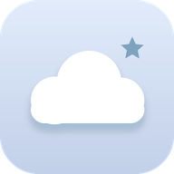
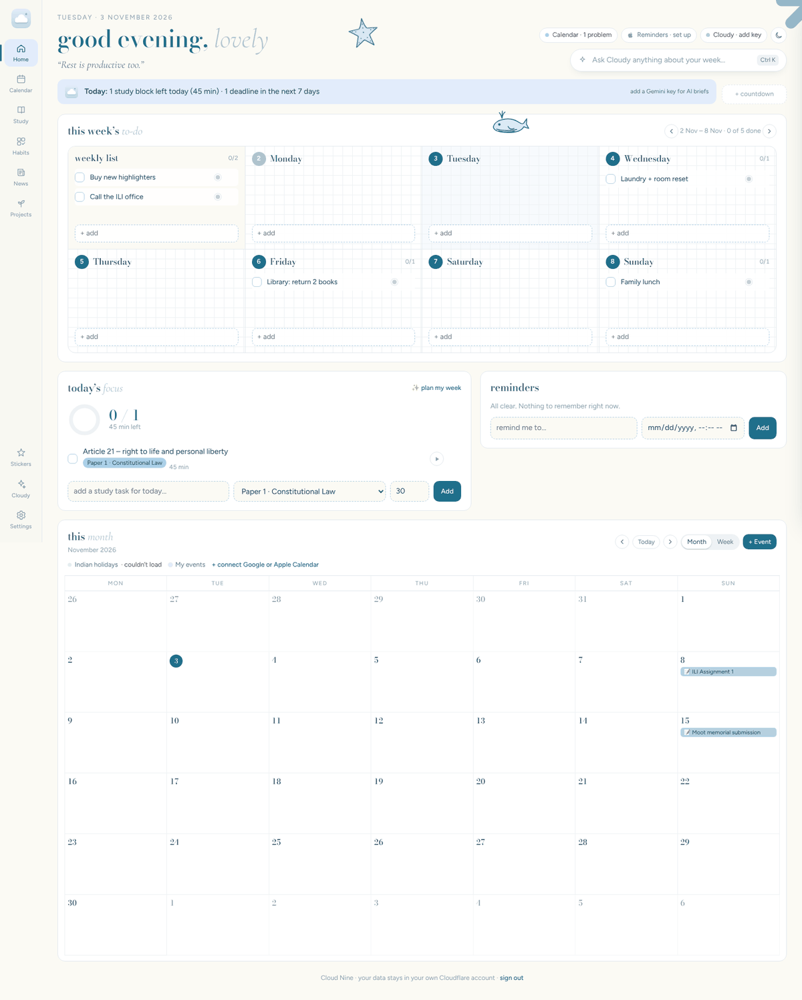
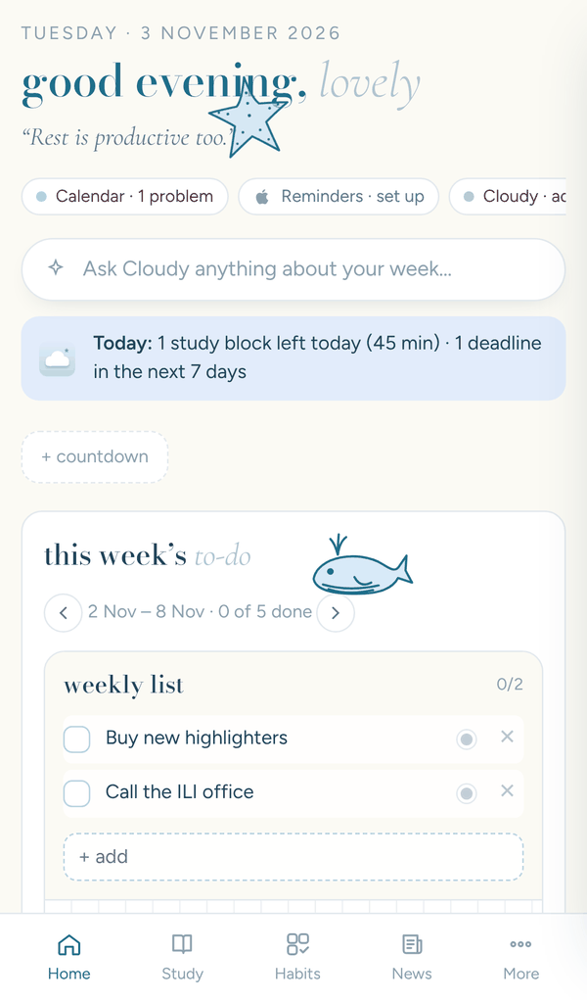
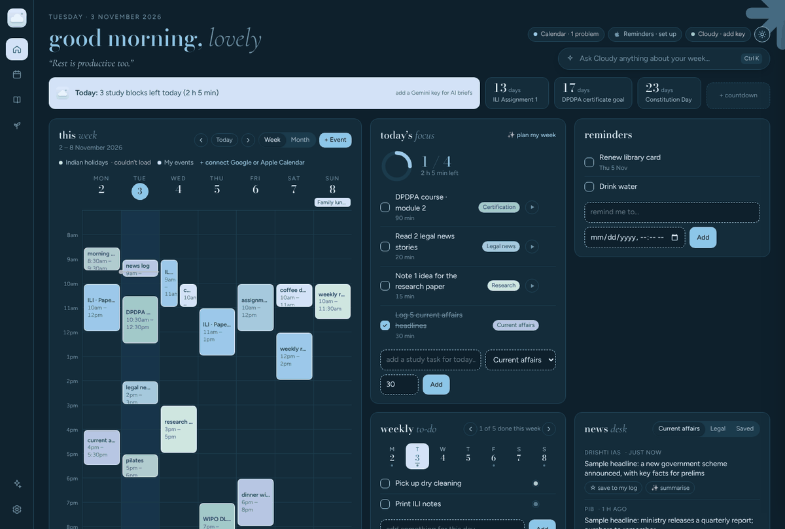

<p align="center"></p>

<h1 align="center">Cloud Nine</h1>
<p align="center"><i>a soft, pastel life planner for study, routines, calendars, news and an AI helper</i></p>

<p align="center"></p>

Cloud Nine puts your whole week on **one screen**: your Google and Apple calendars, a weekly to-do list, today’s study plan with a focus timer, reminders, a current-affairs and legal news desk, habits, and your projects. **Cloudy**, the built-in AI powered by Google Gemini (free key), can plan your study week, summarise news and quiz you.

It runs in any web browser, **installs like a normal app on Windows**, and **adds to your iPhone home screen**. Everything stays in sync between devices.

> The news headlines in these screenshots are samples. In the real app they come from PIB, The Hindu, Indian Express, Drishti IAS, Vision IAS, Vajiram & Ravi, Bar & Bench, LiveLaw and SCC Online.

---

## Get started in 3 steps

| Step | What you do | Guide |
|---|---|---|
| **1. Put it online** (once, about 10 minutes) | Click the button below. It copies Cloud Nine into a free Cloudflare account and gives you a private web link. | [Setup guide](docs/1-SETUP.md) |
| **2. Install it** | Open the link on your Windows PC and iPhone, type your passcode, and install it. | [Windows](docs/2-WINDOWS.md) · [iPhone](docs/3-IPHONE.md) |
| **3. Connect your things** (optional) | Add your calendars, a free Gemini key for Cloudy, and the Apple Reminders shortcut. | [Calendars](docs/CALENDARS.md) · [Cloudy (AI)](docs/GEMINI.md) · [Apple Reminders](docs/APPLE-REMINDERS.md) |

[](https://deploy.workers.cloudflare.com/?url=https://github.com/SriKumar2/LifeStyle-Planner)

Stuck? See [Troubleshooting](docs/TROUBLESHOOTING.md).

---

## What’s inside

- **Week and month calendar** that shows Google Calendar, Apple (iCloud) Calendar and Indian holidays together, plus events you add yourself.
- **Today’s focus**: study tasks for the day, a 25-minute focus timer, and anything carried over from earlier in the week.
- **Weekly to-do** with a tab for each day and soft, important and urgent priorities.
- **Study planner**: a weekly study to-do board with a box per day, a study-hour target, top 3 priorities, weekly goals, deadlines and a weekly review.
- **Syllabus by course**: keep each diploma, exam or certification separate, paste a syllabus, and track every topic from *to study* to *revised*. Subjects stay folded until you open them.
- **Daily routine**: plan your morning, afternoon, evening and night, tick steps off, keep a streak, and choose which days each step happens.
- **Stickers**: drag hand-drawn line-art stickers (sea creatures, books, scales of justice…) onto any card, or upload your own.
- **To-do & lists**: everyday to-dos and checklists (groceries, packing, errands) on the home screen.
- **Reminders**, including the ones on your iPhone (through a small Apple Shortcut).
- **News desk**: English current affairs for government exams, legal news, and a Leisure tab for Substack newsletters, with AI summaries.
- **Habits** tracker, a daily mood check-in and routine notes.
- **Countdowns** to exams, deadlines and special days.
- **Second brain**: projects as checklists, or with rooms for books, shows and movies, a workout log, an ILI diploma planner, certifications (with free law certifications already listed), and research ideas. Add your own projects too.
- **Cloudy (AI)**: a daily brief, chat about your week, a study-week planner that adds tasks for you, news summaries and quizzes.
- **Nine looks**: Ocean milk, Deep ocean, Ink & paper, Matcha strawberry, Sweater weather, Fall, Blueberry pie, Lavender hues, or match your device.

<p align="center">&nbsp;&nbsp;</p>

## Privacy

- Your planner lives in **your own Cloudflare account**, in a private database only your copy of the app can read.
- A **passcode** protects the app. Sign-ins last 180 days per device. Changing the passcode signs every device out.
- Cloudy only sends data to Google Gemini when you use it. On Gemini’s **free tier, Google may use what you send to improve its products**, so keep very private details out of AI chats.
- Calendar links and the reminders token are secret. Treat them like passwords.

## Cost

Free for one person: Cloudflare’s free Workers plan and Gemini’s free tier cover normal use. No card is needed for either.

---

## For developers

Plain JavaScript, no build step.

```
public/          the app: index.html, app.css, app.js, service worker, icons
src/index.js     Cloudflare Worker: routes, passcode sign-in, feed relay
src/store.js     Durable Object with SQLite: all planner data
src/ai.js        Gemini calls (chat, brief, summaries, week planner)
src/seed.js      first-run settings, habits and suggested certifications
```

Run it locally:

```bash
npm install
```

```bash
cp .dev.vars.example .dev.vars
```

```bash
npm run dev
```

Then open http://127.0.0.1:8787 and sign in with the passcode from `.dev.vars`.

Heavy work happens in the browser on purpose. Calendar files and news feeds are relayed by the Worker and parsed on the device, which keeps the Worker inside Cloudflare’s free-plan CPU limit.

License: MIT.
