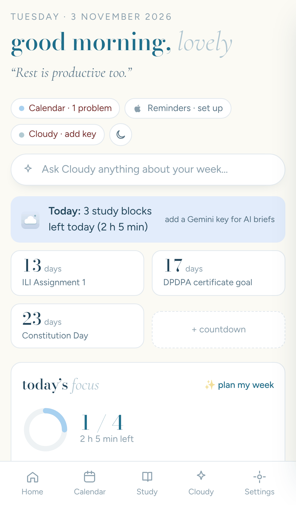

# 3. Use Cloud Nine on iPhone

On iPhone, Cloud Nine goes on your home screen and opens full screen like a normal app. No App Store needed.

You need the **link** and **passcode** from whoever set it up (see [Setup](1-SETUP.md)).

## Add it to your home screen

1. Open **Safari** and go to your Cloud Nine link.
2. Type your **passcode** and tap **Open my planner**.
3. Tap the **Share** button: the square with an arrow pointing up, at the bottom of the screen (or at the top on iPad).
4. Scroll down and tap **Add to Home Screen**.
5. Keep the name **Cloud Nine** and tap **Add**.

Open it from the new cloud icon on your home screen. It opens full screen with a tab bar at the bottom: **Home, Calendar, Study, Cloudy, Settings**.

> On iOS 16.4 and newer you can also do this from Chrome or Edge on iPhone: tap the Share button → **Add to Home Screen**.

## Sign in once inside the app

The home-screen app keeps its own sign-in, separate from Safari. If it shows the passcode screen the first time you open it, type your passcode once more. It then remembers you for 180 days.

## Good to know

- **Everything syncs.** A task added on the iPhone shows up on the Windows app when you switch back to it, and the other way round.
- **Phone alerts:** Cloud Nine can’t buzz your iPhone by itself. For alerts, use the [Apple Reminders shortcut](APPLE-REMINDERS.md): reminders you add in Cloud Nine get copied into Apple Reminders, which alerts you at the right time.
- **Turn the phone sideways** on an iPad for the full desktop layout.
- **Private Browsing:** don’t add the app from a Private Browsing tab. It would forget your sign-in.

## Remove it

Press and hold the Cloud Nine icon → **Remove App** → **Delete from Home Screen**. Your planner stays online.
