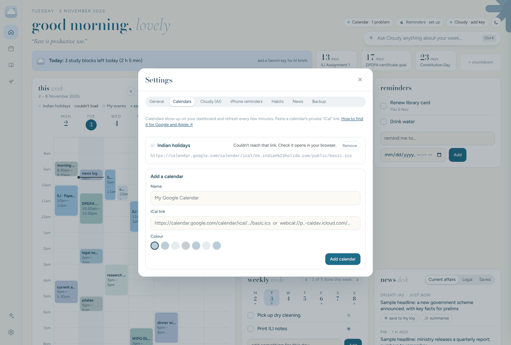

# Show your Google and Apple calendars

Cloud Nine shows your real calendars in its week and month views. Indian holidays are already included.

It works with any calendar that has a private **iCal link** (also called an “.ics” or “webcal” link). Cloud Nine **reads** these calendars and refreshes them every few minutes. Events you create inside Cloud Nine (**+ Event**) are saved in Cloud Nine only.

> **Keep these links secret.** Anyone with the link can see that calendar. If one leaks, reset it (steps below) and add the new link.

## Google Calendar

Do this on a computer. The Google Calendar phone app doesn’t show this setting.

1. Go to [calendar.google.com](https://calendar.google.com) and sign in.
2. Click the **gear** icon (top right) → **Settings**.
3. On the left, under **Settings for my calendars**, click the calendar you want (usually your name).
4. Scroll down to **Integrate calendar**.
5. Find **Secret address in iCal format** and click the **copy** icon.
   - It starts with `https://calendar.google.com/calendar/ical/` and ends with `basic.ics`.
6. In Cloud Nine, open **Settings** → **Calendars**.
7. Type a name (for example, “Google”), paste the link, pick a colour, and click **Add calendar**.

Repeat for each Google calendar you want to see.

- **No “Secret address” option?** Accounts from a school or workplace sometimes have it turned off by the administrator. Use a personal Gmail calendar instead, or ask the administrator.
- **Reset a leaked link:** in the same place, click **Reset** next to the secret address, then remove the old calendar in Cloud Nine and add the new link.

## Apple (iCloud) Calendar

Apple’s option is called **Public Calendar**. It creates a link that only works for people who have it. Nobody can search for it.

### On iPhone

1. Open the **Calendar** app and tap **Calendars** at the bottom.
2. Tap the **ⓘ** next to the calendar you want.
3. Turn on **Public Calendar**.
4. Tap **Share Link…** → **Copy**.
   - It starts with `webcal://`. Cloud Nine accepts it as it is.
5. In Cloud Nine, open **Settings** → **Calendars**, paste the link, and click **Add calendar**.

### On a computer

1. Go to [icloud.com/calendar](https://www.icloud.com/calendar) and sign in.
2. Next to the calendar’s name, click the **share** icon (a person with a +).
3. Tick **Public Calendar** and click **Copy Link**.
4. Paste it into Cloud Nine as above.

To stop sharing, turn **Public Calendar** off again. The link stops working.

## Other calendars

Outlook, Proton, school timetables and sports fixtures usually offer an **ICS** or **iCal** link under “Share” or “Publish”. Paste it the same way.

## How fresh is it?

Cloud Nine fetches each calendar when you open it and every few minutes while it’s open. Google and Apple usually publish changes within minutes, occasionally longer.

## Something wrong?

- **“couldn’t load” next to a calendar:** open the link in a browser tab. If it doesn’t download a file, the link is wrong or was reset.
- **Times are off by a few hours:** check that your computer or phone is set to the right time zone. Cloud Nine shows events in the device’s time zone.
- More fixes in [Troubleshooting](TROUBLESHOOTING.md).
