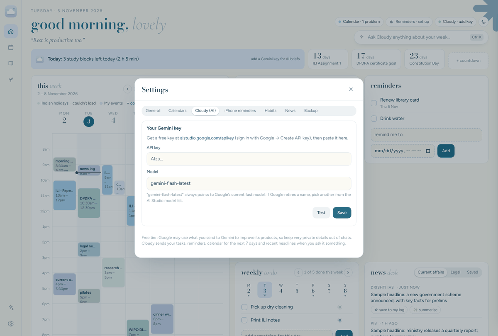

# Turn on Cloudy, the AI helper

Cloudy runs on Google’s **Gemini**. A free Gemini key is enough for everyday use. Getting one takes about two minutes.

## What Cloudy can do

- Write a **one-line brief** at the top of your day.
- Answer questions about your week: “What should I focus on today?”
- **Plan your study week**: it suggests tasks for the next 7 days and you tick the ones to add.
- **Summarise** a headline in the news desk, with why it matters for exams.
- **Quiz you** on the week’s headlines.

## 1. Get a free key

1. Go to [aistudio.google.com/apikey](https://aistudio.google.com/apikey) and sign in with a Google account.
2. Accept the terms if asked.
3. Click **Create API key**. If it asks for a project, choose the default or create one called “Cloud Nine”.
4. **Copy** the key. It starts with `AIza`.

Treat the key like a password. Don’t post it anywhere.

## 2. Add it to Cloud Nine

1. In Cloud Nine, open **Settings** → **Cloudy (AI)**.
2. Paste the key into **API key**.
3. Click **Test**. You should see “✓ Gemini answered…”.
4. Click **Save**.

The key is stored in your own Cloud Nine database and never shown again. You can replace or remove it on the same screen.

## The free tier, honestly

- **It’s free**, with daily limits. Your current limits are shown in [AI Studio](https://aistudio.google.com) under your project’s rate limits. They reset every night (US Pacific time).
- **Privacy:** on the free tier, Google may use what you send to improve its products. Cloudy sends your tasks, reminders, the next 7 days of your calendar and recent headlines when you ask it something. Keep very private details out of chats. On a paid Gemini plan, Google doesn’t use your data this way.
- **No Google Search on the free tier.** That’s fine here: Cloud Nine fetches the news itself and gives Cloudy the headlines.

## Model name

Cloud Nine uses `gemini-flash-latest`, which always points to Google’s current fast model. If Google ever retires a name and Cloudy says “model not found”, open [AI Studio](https://aistudio.google.com), copy the name of a current Flash model, and paste it into **Settings → Cloudy (AI) → Model**.

## Errors you might see

| Message | What to do |
|---|---|
| “Add your free Gemini API key…” | No key saved yet. Follow the steps above. |
| “…hit today’s free limit…” | Wait until tomorrow, or use Cloudy a little less. |
| “…not found…” or “…not supported…” | Change the model name (see above). |
| “API key not valid” | Copy the key again from AI Studio and save it. |
