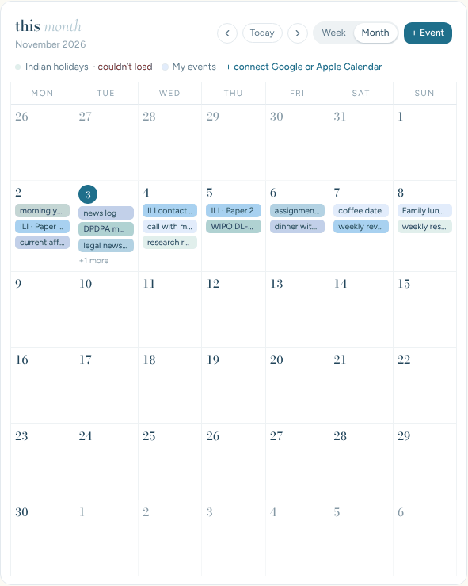
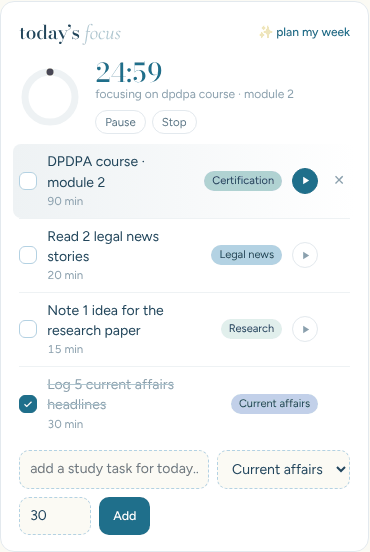
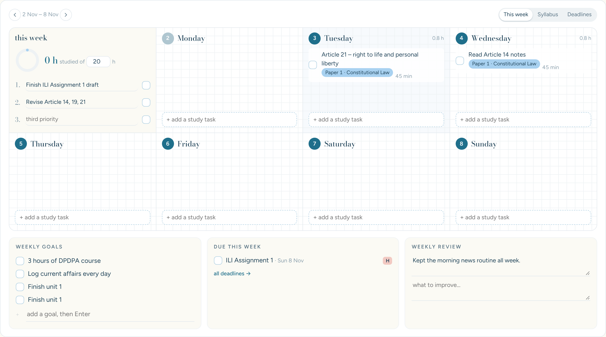
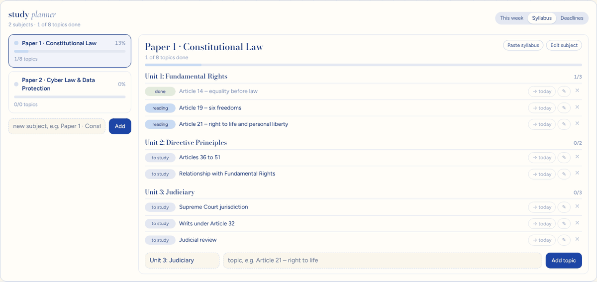
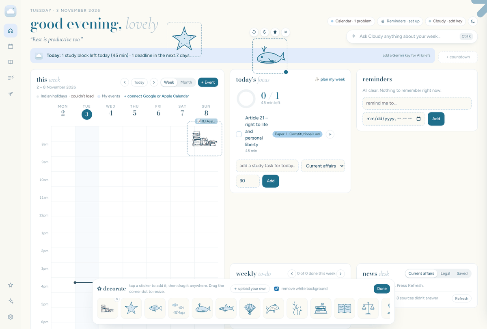
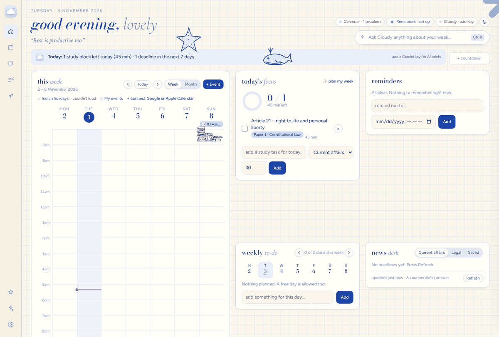
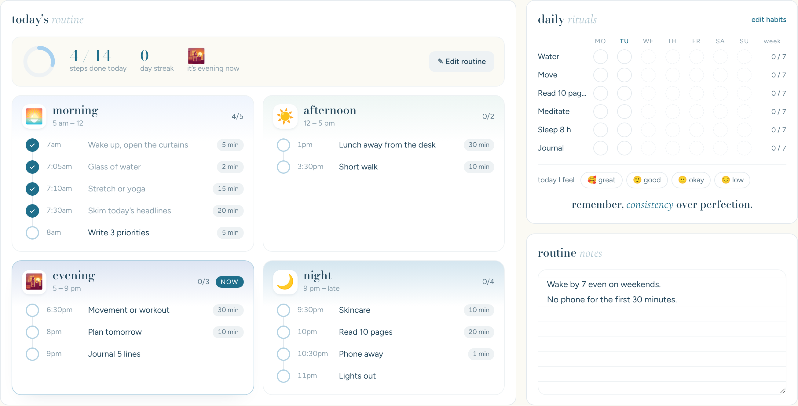
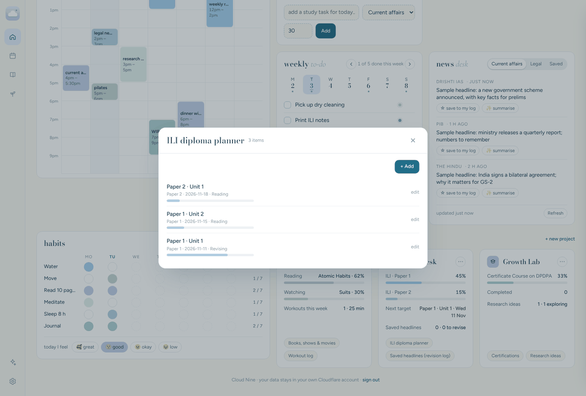

# Using Cloud Nine

## Getting around

Cloud Nine has six pages. On a computer, use the panel on the left; on a phone, use the bar at the bottom (Calendar, Projects, Stickers, Cloudy and Settings are under **More**).

| Page | What’s on it |
|---|---|
| **Home** | This week’s to-do, today’s focus, reminders, and the month calendar |
| **Calendar** | The calendar on its own, full screen, in month or week view |
| **Study** | The study planner: this week’s study to-do, your syllabus by course, deadlines |
| **Routine** | Your daily routine (morning to night), habits, mood and routine notes |
| **News** | The news desk: current affairs and legal news |
| **Projects** | Your second brain: projects and their rooms |

Home stays calm on purpose: everything else is one tap away.

## The top

- **Greeting and quote.** The quote changes every day. Change the name it calls you in **Settings → General**.
- **Status chips** show whether your calendars, iPhone reminders and Cloudy are connected. Tap one to fix or set it up.
- **Moon / sun** switches between day (“ocean milk”) and night (“deep ocean”).
- **Ask Cloudy…** (or **Ctrl + K**) opens the AI helper.
- **Today / Cloudy’s brief** sums up your day. With a Gemini key, Cloudy writes it each morning.
- **Countdowns** show days left until exams or special dates. Tap **+ countdown** to add one, or tap a countdown to change or delete it.

## Calendar

- The month calendar sits at the bottom of Home, full width. Open the **Calendar** page for it on its own.
- Switch between **Month** and **Week**, and move with **‹ Today ›**.
- **+ Event** adds an event saved in Cloud Nine. In the week view you can also **click an empty time** to add an event there.
- Click any event to see its details. Events from Google or Apple open read-only; change those in their own apps.
- In the month view, click a day to see everything on it.

## Today’s focus

Your study tasks for today, plus anything left unfinished from the past week (marked “carried over”).

- Add a task with its subject and minutes at the bottom.
- Press **▶** to start a **25-minute focus timer** for that task. When it ends, Cloud Nine counts the minutes and suggests a short break.
- **✨ plan my week** asks Cloudy to suggest study tasks for the next 7 days. Untick any you don’t want, then add the rest.

## Reminders

Open reminders, soonest first. Overdue ones turn red. Add one with an optional date and time. Reminders from your iPhone show the  logo (see [Apple Reminders](APPLE-REMINDERS.md)).

## This week’s to-do

The first thing on Home: a **weekly list** box for anything without a day, then one big box for each day of the week, like a paper weekly plan. Type in a box’s **+ add** and press Enter. The coloured dot is the priority: tap it to switch between soft, important and urgent. Use **‹ ›** at the top right to look at other weeks.

## News desk

- On the **News** page. **Current affairs** and **Legal** tabs fill up when you open the app (at most every 3 hours) or when you press **Refresh**.
- Only **English** headlines are shown. Headlines in Hindi or other Indian scripts are skipped.
- Sources: **Current affairs** comes from PIB, The Hindu, Indian Express (UPSC and Explained), Drishti IAS, Vision IAS and Vajiram & Ravi. **Legal** comes from Bar & Bench, LiveLaw and SCC Online. The coaching and legal sites show only their English news pages from the last 7 days.
- **✨ summarise** asks Cloudy for three key points and why the story matters.
- Add or remove sources in **Settings → News**. Typing just a website, such as `vedantu.com`, follows it through Google News.

## Study planner

On the **Study** page. It has three tabs.

**This week** is the main view: a board with a box for each day of the week.

- Type in a day’s **+ add a study task** box and press Enter. Pick the subject from the list that appears under the box.
- Tick tasks off as you finish them. Each day shows how many hours you planned.
- The first box, **this week**, holds your **study-hour target** (with a ring that fills as you study) and your **top 3 priorities**.
- Under the board: **weekly goals**, what’s **due this week**, and a short **weekly review** (what went well, what to improve).
- Use **‹ ›** at the top to look at other weeks.

**Syllabus** keeps every course separate, so it’s always clear what a subject belongs to.

1. **Courses** sit in tabs across the top, for example *PG Diploma · ILI*, *Judiciary exam prep* or a certification. Press **+ course** to add one. Give it a type, an exam or end date, and a colour.
2. Each course lists its **subjects** as single tidy rows, each with a progress bar. Nothing else shows until you need it, so the page stays short however long the syllabus gets.
3. Tap a subject to open it. Topics are grouped by unit. Units you’ve finished fold into one line, and finished topics are hidden. Press **✓ done · show** to see them again.
4. Add topics one by one, or press **Paste syllabus** and paste the whole list. Lines that start with *Unit*, *Module*, *Chapter* or *Part*, or end with a colon, become unit headings. Bullets and numbering are removed for you.
5. Tap a topic’s status to move it along: **to study → reading → done → revised**.
6. **→ today** puts a topic into Today’s focus on Home. Ticking that task off marks the topic done.
7. **Edit subject** sets an exam date (shown as a countdown), a colour, and which course it belongs to. **Edit course** renames or removes a course.

**Deadlines**: every assignment with its subject, due date, priority (**H / M / L**) and a done box. Deadlines also appear on the calendar (📝) and in the daily brief.

Cloudy can see your syllabus (by course), deadlines and today’s routine, so you can ask things like “Which topics should I revise before the Paper 1 exam?”

## Stickers

Press the ☆ **decorate** button (left rail on a computer) to open the sticker tray.

- Tap a sticker to add it, then **drag** it anywhere. It stays attached to the card you drop it on, so it moves with that card on a phone too.
- Drag the **dot** at its corner to resize. Use ↺ ↻ to rotate, ⬆ to bring it to the front, ✕ to remove it.
- **＋ upload your own** adds any picture as a sticker. Leave **remove white background** ticked for drawings on white paper.
- Press **Done** when you’re finished. Stickers are shared across your devices.

## Looks

**Settings → General → Look** offers three themes: **Ocean milk** (pastel day), **Deep ocean** (night) and **Ink & paper** (navy ink on cream grid paper). The choice follows you to every device.

## Routine

The **Routine** page is where you write down your routine and follow it each day.

- The first time, press **Start with a gentle routine** for a ready-made one you can change, or **Start from scratch**.
- Your day is split into **morning, afternoon, evening and night**. Each step has a time, a name and how many minutes it takes. The part of the day you’re in now is marked **now**.
- Tap the circle next to a step to tick it off. The top of the page shows how many steps you’ve done today and your **streak** (days in a row with at least 80% done).
- **✎ Edit routine** lets you change times, names and minutes, remove steps, and add new ones to each part of the day. Tap the day letters (**M T W T F S S**) to choose which days a step happens, for example a long walk only on weekends. Changes save as you type.
- **Routine notes** is a free space for the why: your non-negotiables, what you’re trying this week, anything you want to remember.

**Daily rituals**, beside it, is the habit tracker. Tap a circle to tick a habit for that day. Rename habits, change colours or add new ones with **edit habits**. Below the grid, pick how you feel today.

## Second brain

Each project card shows a summary and its **rooms**. Tap a room to see, add and edit its items.

| Project | Rooms |
|---|---|
| Soft Living | Books, shows & movies · Workout log |
| Study Desk | Syllabus (every course, with its progress) |
| Growth Lab | Certifications (free law certifications already listed) · Research ideas |

Use **+ new project** for your own (for example “Moot court” or “Travel”). The **⋯** button on a card renames or removes it.

## Backup

**Settings → Backup → Download backup** saves everything as one file. Do this now and then for peace of mind.
